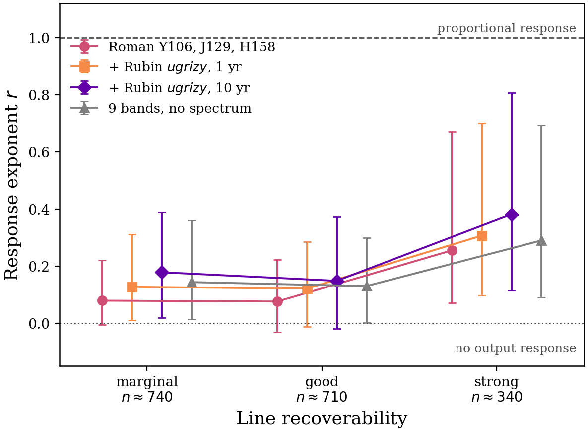
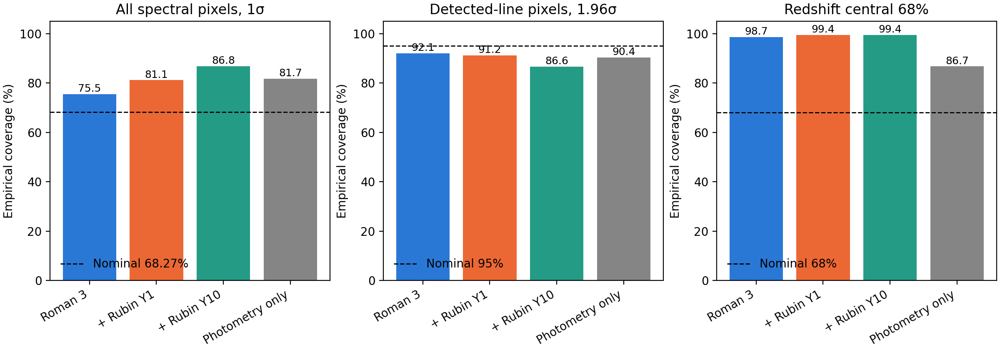

# Release 0.6.1: audits of the independently trained weights

The nine weights and four test prediction caches are unchanged from v0.6.0.
These diagnostics use all 2,384 reserved test spectra of 1,005 galaxies.
No calibration was fitted, and no checkpoint was selected, on these results.

The galaxies were reserved from checkpoint selection for the new runs, but
appeared in historical validation during development. This is not a fully
prospective sample or a test outside the Diffsky simulation manifold.

## Response to changing a line

The strongest target line is halved or doubled, its difference is smoothed
with the Gaussian grism LSF and added to the input in extraction units.
The original errors and each source's noisy photometry are held fixed.
Audit noise draws use per-source iteration; frozen prediction caches use batches.
The primary response includes the deployed input-dependent LR restoration.
Eligibility requires best-line expected S/N ≥ 2 and positive baseline recovery
of at least 20% in both stages. All 1,819 candidate spectra were attempted.
This approximates spectral injection; it does not repeat 2D morphological dispersion.

| Configuration | Eligible spectra | SR1 median r | SR2 median r (95% bootstrap) | SR2, strong lines |
|---|---:|---:|---:|---:|
| Roman three bands | 1,786 | 0.220 | 0.098 (0.089–0.106) | 0.255 |
| + Rubin Year 1 | 1,786 | 0.220 | 0.147 (0.136–0.158) | 0.306 |
| + Rubin Year 10 | 1,786 | 0.220 | 0.188 (0.178–0.200) | 0.381 |
| Photometry-only redshift | 1,786 | 0.220 | 0.158 (0.147–0.172) | 0.289 |

Intervals use 1,000 galaxy-grouped bootstrap draws (seed 0), retaining all
visits and perturbations of each sampled galaxy. Medians pool spectrum/factor
responses. Strong lines have original expected S/N > 6.

| Configuration | SR2 r, halving | SR2 r, doubling |
|---|---:|---:|
| Roman three bands | 0.098 | 0.098 |
| + Rubin Year 1 | 0.146 | 0.147 |
| + Rubin Year 10 | 0.205 | 0.166 |
| Photometry-only redshift | 0.148 | 0.173 |

Response 1 means proportional output change in the selected restoration;
response 0 means no output change. Low response to an injection below the noise
can be appropriate. Original and injected-change S/N breakdowns are retained
in the JSON and per-response records. A pooled exponent is not a fraction of
flux attributable to a learned prior, nor a single doubling prediction.

## Normalization control

Fixed-target restoration holds the target mean and scale constant and isolates
normalized network output. Input normalization can remove amplitude changes
even for an identity estimator, so this is not a corrected physical response.
The comparison below matches valid source IDs and perturbation factors.

| Configuration | Matched SR2 responses | Deployed r | Fixed-target r |
|---|---:|---:|---:|
| Roman three bands | 3,457 | 0.096 | 0.043 |
| + Rubin Year 1 | 3,462 | 0.143 | 0.086 |
| + Rubin Year 10 | 3,465 | 0.184 | 0.132 |
| Photometry-only redshift | 3,464 | 0.156 | 0.096 |

## Uncertainty coverage

These are coverage diagnostics, not a fitted correction. Gaussian reference
coverage is 68.27% within 1σ and 95% within 1.96σ. Redshift coverage uses the
central 68% P(z) interval with uniform density within each 0.01-wide bin.
Bin-midpoint coverage and randomized PIT diagnostics are also retained.

| Configuration | All pixels, 1σ | Detected-line pixels, 1σ | Detected-line pixels, 1.96σ | Redshift central 68% |
|---|---:|---:|---:|---:|
| Roman three bands | 75.5% | 77.8% | 92.1% | 98.7% |
| + Rubin Year 1 | 81.1% | 74.8% | 91.2% | 99.4% |
| + Rubin Year 10 | 86.8% | 68.5% | 86.6% | 99.4% |
| Photometry-only redshift | 81.7% | 73.2% | 90.4% | 86.7% |

P(z) intervals over-cover this sample; their bin width also limits local
precision. Spectral uncertainties are conservative in aggregate but miss
nominal 95% coverage in detected-line tails. One global variance scale is
not established by these results. Any fitted recalibration needs validation
data and a separate evaluation; none was fitted on the test partition.

## Unsupported-emission proxies

The diagnostic uses truth-centered, overlapping Gaussian windows
(σ = 0.005 µm), smoothed-continuum subtraction, and a threshold of 5 in
standardized weighted-sum units. Off-grid windows are excluded. These
proxies are not blind line-search false-positive rates.

| Configuration | Weak-target windows above threshold | Present but expected S/N < 2, above threshold |
|---|---:|---:|
| Roman three bands | 24/3,859 (0.62%) | 1,572/4,325 (36.3%) |
| + Rubin Year 1 | 12/3,859 (0.31%) | 1,513/4,325 (35.0%) |
| + Rubin Year 10 | 16/3,859 (0.41%) | 1,579/4,325 (36.5%) |
| Photometry-only redshift | 24/3,859 (0.62%) | 1,629/4,325 (37.7%) |

Line recovery against simulated targets remains distinct from measuring
physical line fluxes. The weak perturbation response, uncertainty mismatch,
historical development exposure, and simulation domain limit scientific use.

## Reproduce

Install `specsr-roman[hub]` and obtain the source scripts from the v0.6.1
release. Download the full dataset and four v0.6.0 test caches from HF.
Both local training outputs and `--runs hub` are supported by the audit runner.
Use a fresh output directory; do not overwrite an earlier audit generation.

```bash
python scripts/run_response_audits.py --runs hub --output-scale legacy_lr --outdir outputs/audits/lr_restored
python scripts/run_response_audits.py --runs hub --output-scale target_fixed --outdir outputs/audits/target_fixed
# Repeat the coverage command for all four caches/configurations:
python scripts/validate_frozen_results.py --cache outputs/pred_cache.npz --out outputs/audits/calibration/roman3.json
python scripts/summarize_release_audits.py --caches outputs --audits outputs/audits
```

The bundle includes the four coverage reports, eight response summaries,
eight per-response NPZ files, matched normalization comparisons, galaxy-grouped
intervals, input checksums, exact model identities, and source scripts.

## Figures





[Exact summary](../_static/audits-0.6.1/summary.json) and the
[HF audit bundle](https://huggingface.co/datasets/aryana-haghjoo/romansr-data/tree/v0.6.1/releases/v0.6.1/audits)
include the numerical records.
